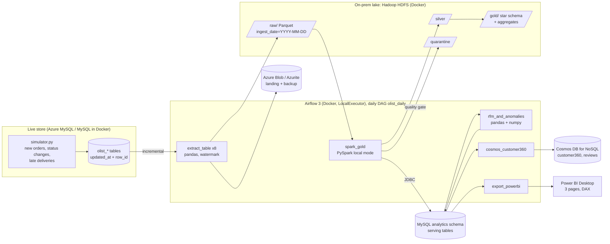
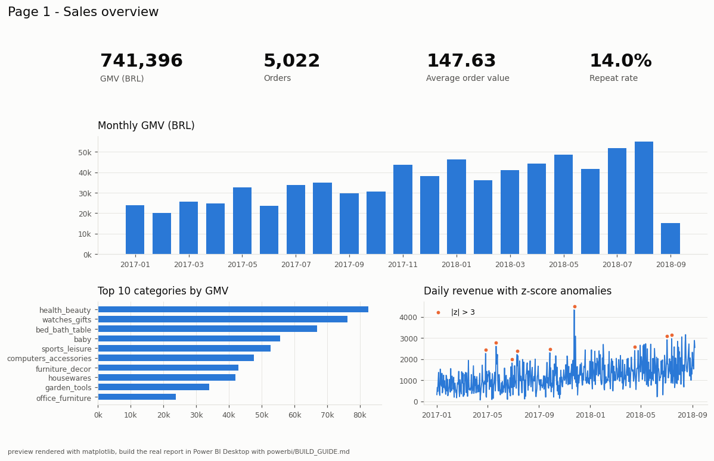
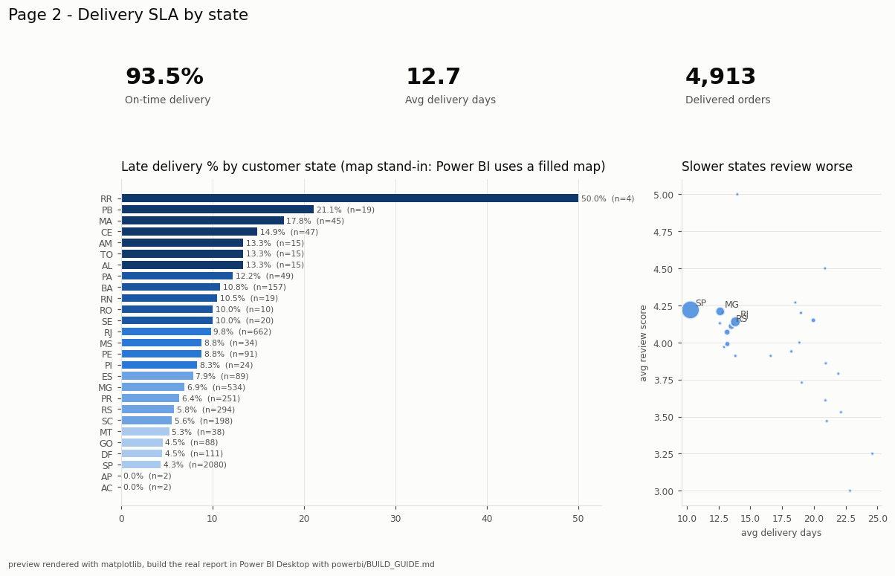
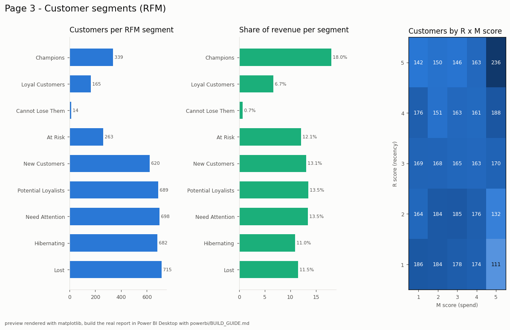

# E-commerce Order and Customer Analytics: a hybrid on-prem / Azure pipeline

An online marketplace wants three answers every morning: how much did we sell, where are
deliveries slipping, and which customers are worth keeping close. This repo builds the
whole data path behind those answers. Orders live in a MySQL OLTP database. A daily
Airflow 3 DAG pulls only what changed since the last run, lands it as Parquet in an
"on-prem" Hadoop HDFS lake with an off-site copy in Azure Blob Storage, and a PySpark job
cleans it, runs a data quality gate, and builds a star schema. The gold tables are served
back to MySQL for BI, pandas and numpy add RFM segments and revenue anomaly flags, one
customer 360 document per customer goes to Cosmos DB for NoSQL, and a three-page
Power BI report sits on top. Every piece runs on a free tier or a free local emulator.

The data has the exact shape of the Olist Brazilian E-Commerce dataset from Kaggle: the
same eight tables, the same column names, even the same typo (`product_name_lenght`). A
deterministic generator produces it, so the repo runs on a fresh clone with no download.
Drop the real Olist CSVs into `data/raw/olist/` and the same code runs on them.

## Architecture



## Stack, and why each piece is there

| Piece | Job here | Why this choice | Runs on ($0) |
|---|---|---|---|
| **MySQL** | The shop's live OLTP store. Every row carries `updated_at` and an auto-increment `row_id`. Also the serving layer (`analytics` schema) that BI tools read. | A typical application database; `updated_at` plus `row_id` is what makes incremental extraction possible without CDC tooling. | `mysql:8.4.6` in Docker, or Azure Database for MySQL Flexible Server B1ms |
| **pandas watermark extract** | Pulls only rows changed since the last run, using a composite `(updated_at, row_id)` watermark and keyset pagination, and writes Parquet with a fixed Arrow schema. | The `row_id` tie-break means rows sharing a timestamp are never skipped or duplicated. Checkpoints make a rerun of the same day read the same window. | Host and Airflow container |
| **Airflow 3** | Daily DAG `olist_daily`: 8 mapped extract tasks, Spark, analytics, then Cosmos and Power BI export in parallel. | The DAG is thin; every task is one call into the `olistpipe` package, so the CLI and the DAG run identical code. | Docker, official compose slimmed to LocalExecutor |
| **Hadoop HDFS** | The on-prem data lake: `raw`, `silver`, `gold` and `quarantine` zones, raw partitioned by `ingest_date`. | Stands in for the on-prem cluster in a hybrid design. | `apache/hadoop:3.4.1`, one namenode and one datanode |
| **Azure Blob Storage** | Landing and off-site backup copy of every raw file. | The cloud half of the hybrid: raw data survives the loss of the on-prem cluster. | Azurite emulator, or a real storage account |
| **Spark (PySpark)** | `row_number` dedupe, cleaning, star schema (facts at order and order-item grain, customer/product/seller/date dimensions), aggregates. Small dimensions are joined with `F.broadcast`, confirmed as `BroadcastHashJoin` in the plan. | Broadcasting a ~70-row translation table or the product dimension avoids shuffling the large fact table. | Docker only, `local[*]` |
| **Data quality gate** | Row-level rules; failing rows go to `quarantine` with the rules they broke. If any table's bad-row share exceeds the threshold (2% by default) the job exits with code 2 and gold is not written. | Bad data stops the pipeline visibly instead of flowing into the report. | Inside the Spark job |
| **MySQL serving via JDBC** | Spark writes gold tables to the `analytics` schema. | BI tools and analysts query plain SQL tables, not Parquet. | Same MySQL |
| **Cosmos DB for NoSQL** | One "customer 360" JSON document per customer, plus review documents. Sync is hash-based, so unchanged documents are not rewritten. | Partition keys follow the access pattern: `customer360` on `/customer_unique_id` (a point read per person, high cardinality). Not `customer_id`, which Olist mints per order, and not `customer_state`, which has 27 values with about 42% in one state (a hot partition). `reviews` on `/order_id`, since support tools open an order and ask for its review. | Linux vnext emulator, or the Cosmos DB free tier |
| **pandas + numpy analytics** | RFM scores with `np.percentile` and `np.digitize`; rolling z-scores on daily revenue to flag anomalies. | Small aggregated data does not need Spark. | Host and Airflow container |
| **Power BI** | 3-page report built from the exported gold tables, with 10+ DAX measures. | The measures are recomputed in pandas so the report numbers can be checked. | Power BI Desktop (free) |

`RUN_MODE=local` (the default) points everything at the Docker emulators. `RUN_MODE=azure`
swaps in real Azure MySQL, Blob and Cosmos; nothing else changes. The scripts in `azure/`
create those resources on the free tier and start with a $5 budget alert. HDFS, Spark and
Airflow stay in Docker because the managed Azure versions have no free tier.

Spark never runs on the Windows host. PySpark needs Java, and on bare Windows it also
needs `winutils.exe`; every Spark job and test runs in a container instead.

## Quickstart (PowerShell)

Needs Python 3.11+ and Docker Desktop (plan for about 6 GB of RAM for the stack).

```powershell
python -m venv .venv ; .venv\Scripts\Activate.ps1
pip install -r requirements.txt
python -m pytest                                   # offline tests: SQLite + fakes
python -m olistpipe generate --orders 5000         # Olist-shaped CSVs in data\raw\olist
Copy-Item .env.example .env
docker compose --profile tools build               # Airflow + Spark images, once
docker compose up -d                               # wait for (healthy): docker compose ps
python -m olistpipe seed-mysql
docker compose exec airflow-scheduler airflow dags test olist_daily 2018-08-31
python -m olistpipe simulate --day 2018-09-01 --days 7
docker compose exec airflow-scheduler airflow dags test olist_daily 2018-09-07
docker compose down -v
```

Spark tests run inside the Spark image:

```powershell
docker compose run --rm spark python -m pytest tests/spark -p no:cacheprovider
```

Local UIs: Airflow `localhost:33080`, HDFS `localhost:33870`, Cosmos data explorer
`localhost:33234`, Spark UI `localhost:33040` (while `spark_gold` runs). MySQL is on
`localhost:33306`. All host ports are 33xxx so the stack can run next to other projects.

## Verified results

5,000 generated orders seeded into MySQL, one full DAG run for 2018-08-31, seven
simulated days at 15 new orders a day, then the DAG for 2018-09-07 twice:

```
extract 2018-08-31   olist_orders 5,000 rows (new window)        full history
quality gate         19 orders, 46 items, 18 reviews quarantined (all tables < 1%)  PASS
gold                 fact_orders 4,981 | fact_order_items 5,633 | dim_customer 4,159
plan                 BroadcastHashJoin (fact_order_items x dim_product)
anomalies            9 days with |z| > 3, Black Friday 2017-11-24 at z = +7.9
cosmos               4,104 customer360 + 4,754 review documents upserted

extract 2018-09-07   olist_orders 229 rows (105 new orders + 124 status changes)
cosmos               481 customer docs changed, 161 new reviews
rerun 2018-09-07     every table "(RERUN same window)"; serving tables identical
                     (5,086 orders, GMV 741,395.52, 0 duplicate order ids); 0 Cosmos upserts
headline measures    GMV 741,395.52 BRL | AOV 147.63 | on-time 93.45% | repeat rate 14.0%
```

The rerun is the point: running the same day twice leaves the serving tables identical
and writes nothing to Cosmos, so a retried or backfilled day is safe.

Tests: 29 host tests (SQLite and an in-memory Cosmos fake) and 8 Spark tests (inside the
Spark container) pass. CI runs both on every push with no secrets and no services.

### Bugs found and fixed while verifying the full run

- **Booleans came back as bytes.** Spark's JDBC writer maps `BooleanType` to MySQL
  `BIT(1)`, which Python drivers read back as `b'\x00'` / `b'\x01'`. Boolean columns are
  now cast to `TINYINT` 0/1 before the write.
- **A rerun looked like a change.** The Cosmos sync hashes each customer document. An
  unordered MySQL read summed floats in a different order on the rerun, which moved the
  last cent after rounding and made an unchanged document look changed. Serving reads now
  use `ORDER BY`, and the rerun does 0 upserts.
- **HDFS namenode would not format on first start.** The namenode name directory has to
  be a subfolder of the mounted volume (`/hadoop/dfs/name` inside a `/hadoop/dfs`
  volume), otherwise the image cannot format it.

## Power BI





These previews are rendered with matplotlib from the committed gold exports in
`powerbi/gold_exports/`, so the README has pictures. The real report is built in Power BI
Desktop by following `powerbi/BUILD_GUIDE.md`, with `measures.dax` and `theme.json`.

## Repo layout

```
olistpipe/          Python package: schema, generator, loader, simulator, incremental
                    extract, storage (HDFS / Blob / local), RFM, anomalies, Cosmos,
                    serving, Power BI exports, config (RUN_MODE=local|azure)
spark_jobs/         PySpark: transforms (pure functions), dq (rules, quarantine, gate),
                    build_gold (the job)
dags/               Airflow 3 DAG olist_daily
sql/mysql/          init scripts run by the MySQL container on first start
docker/             Dockerfiles for the Airflow and Spark images
docker-compose.yml  the whole stack, compose project de33
tests/              pytest; tests/spark runs inside the Spark container or in CI
data/sample/olist/  1,000-order generated sample, committed so tests work on clone
powerbi/            BUILD_GUIDE.md, measures.dax, theme.json, gold_exports/, previews/
azure/              az CLI scripts for the real free tier (budget alert first)
hosting/            hosting guide, deploy checklist, reference copy of the CI workflow
```

## Limitations

- **Synthetic data by default.** The generator produces Olist-shaped data with
  deliberate mess (bad casing and whitespace that cleaning fixes, impossible values
  such as negative prices that the quality gate quarantines). The real Olist
  dataset is CC BY-NC-SA 4.0, so it is not in this repo; download "Brazilian E-Commerce
  Public Dataset by Olist" from Kaggle, put the eight CSVs in `data\raw\olist\` with their
  original names, and run `seed-mysql`. The first DAG run date for the real data is
  2018-10-17. `.gitignore` keeps those files out of git.
- **No .pbix file.** Power BI Service needs a work or school account, so the deliverable
  is the build guide, the DAX measures, the theme and the gold exports. The preview
  images are matplotlib renderings, not screenshots of Power BI.
- **Cosmos RU charges from the emulator are not real prices.** The emulator reports flat
  request charges; real Azure RU costs differ.
- **Gold is rebuilt in full each run.** Extraction is incremental, but the Spark job
  rebuilds silver and gold from every raw partition up to the run date, every day. Fine at this size; a larger
  dataset would want incremental merges into gold.
- **CI covers units, not wiring.** CI proves the pandas and Spark logic; that HDFS,
  Airflow, MySQL, Azurite and the Cosmos emulator work together is shown by the Docker
  run above, not by CI.
